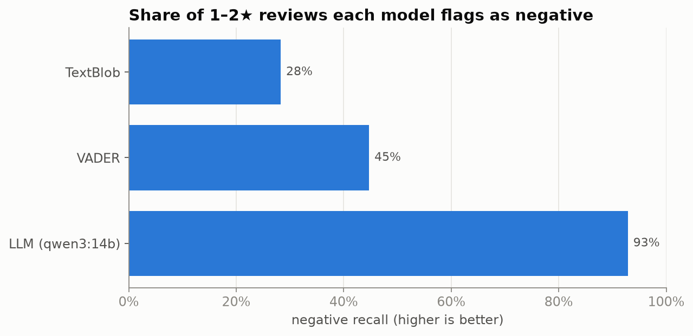
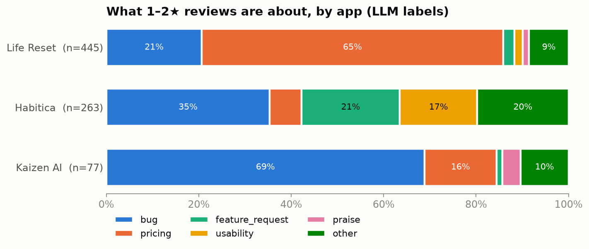

# App Review Insights

**Using a local LLM to sort 3,670 Google Play reviews into bugs, pricing complaints and feature requests, with a hand-labelled benchmark to show how far to trust it.**

Three gamified habit apps are compared: **Life Reset** (the target) and two competitors, **Kaizen AI** and **Habitica**. The project asks three questions:

1. Can off-the-shelf sentiment models find unhappy users? I measure each model against the reviewer's own star rating instead of judging it by eye.
2. Can a local LLM label what a review is *about* reliably? I benchmark it against 200 reviews I labelled by hand.
3. What do the target app's users complain about and ask for, compared with its competitors?

📓 **Full analysis:** [`notebooks/analysis.ipynb`](notebooks/analysis.ipynb)

## Key findings

**A local LLM finds twice as many complaints as VADER.** `qwen3:14b`, running on a laptop through Ollama, flags 93% of 1–2★ reviews as negative. VADER flags 45% and TextBlob 28%. Lexicons miss complaints that state a fact without emotional words ("you can't use it at all for free").



**Its intent labels agree with mine 80% of the time** (95% CI 75–86%, Cohen's κ = 0.75) on 200 hand-labelled reviews. Always guessing the most common label scores 34%. A second annotator labelling blind from the same guide reaches 84% (κ = 0.79), so the model is close to what the label definitions allow. It is reliable on bugs (F1 0.89) and pricing (F1 0.92), and weak on *usability*, as was the second annotator. That points to a fuzzy definition, not a weak model.

**Life Reset's problem is the paywall.** 65% of its 1–2★ reviews are about pricing: users answer a long setup survey and only then find there is no free tier or trial. Competitors' complaints are mostly bugs (Kaizen AI) or spread across bugs, requests and usability (Habitica).



**Life Reset's rating rose from under 2★ to about 4★ in July 2026, but the complaint didn't go away.** Reviews became much shorter (median 17–24 words → 2–5), and among 1–2★ reviews pricing is still 62% of complaints (67% before). Pricing complaints also collect 80% of all thumbs-up on its 1–2★ reviews.

**Feature requests hide in low ratings too.** The first version of this project looked for requests in 4–5★ reviews with negative text. That finds 3 Life Reset reviews, none of them requests. The LLM finds 35, half of them rated 3★ or lower. The most common request is customising the program: days, times and wake-up hours for night-shift workers.

**Methodology fix from the first version:** removing stopwords before sentiment scoring deletes *not*, *no* and *nor*. "No free version, no trial period" becomes "free version trial period", which scores as positive. Cleaning first cost VADER 10 points of negative recall.

## How the benchmark works

- **Sample:** 200 reviews (120 Life Reset, 40 per competitor), balanced across 1–2★, 3★ and 4–5★ so it isn't dominated by short praise.
- **Blind:** star ratings and model output were hidden while labelling (`python -m reviewinsights.label`, a keyboard labeller).
- **Same instructions:** the labelling guide ([`data/labels/README.md`](data/labels/README.md)) and the model's prompt use identical definitions and tie-break rule.
- **Second annotator:** Claude (an AI assistant) labelled the same reviews blind from the guide. This is a reference point, not human inter-annotator agreement.

## Project structure

```
src/reviewinsights/
  config.py       apps under study, date window, model name, paths, random seed
  scrape.py       fetch reviews → data/raw/reviews.csv (raw text, never modified)
  preprocess.py   tokenising for topic models; legacy cleaner kept for comparison
  sentiment.py    VADER / TextBlob scoring, evaluation against star ratings
  topics.py       LDA with coherence-based choice of k and bigram detection
  llm.py          intent + sentiment classification with a local Ollama model
  benchmark.py    draw the labelling sample; score the LLM against human labels
  label.py        keyboard labelling tool
  plots.py        shared chart style
notebooks/analysis.ipynb        the analysis and write-up
data/raw/reviews.csv            review snapshot (no reviewer names stored)
data/processed/llm_labels.csv   LLM labels for every review
data/labels/                    hand labels, second-annotator labels, labelling guide
figures/                        charts exported by the notebook
```

## Run it

```bash
python -m venv .venv && source .venv/bin/activate
pip install -r requirements.txt && pip install -e .

jupyter notebook notebooks/analysis.ipynb      # uses the committed data and LLM labels
```

To reproduce the LLM labels (about 50 minutes for 3,670 reviews on an M4 Pro):

```bash
ollama pull qwen3:14b
python -m reviewinsights.llm                    # resumable; skips reviews already labelled
python -m reviewinsights.benchmark score        # compare with the hand labels
```

`python -m reviewinsights.scrape` refreshes the reviews, but the numbers will then change. Requires Python 3.10+.

## Limitations

- The benchmark has one human labeller and 200 reviews. The second annotator is an AI model.
- Star ratings are a noisy label for sentiment.
- The Play Store API returns only part of each app's reviews, in English, from the US store.
- LDA could not separate complaint types on these short reviews (coherence 0.30), so topic modelling plays only a small part in the analysis.

## Next steps

- Tighten the *usability* and *other* definitions and relabel.
- Have a second human label the same 200 reviews.
- Compare a smaller model (for example `qwen3:4b`) for speed against accuracy.
